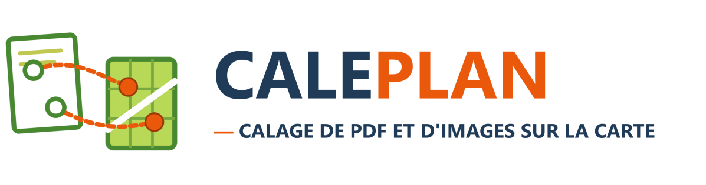
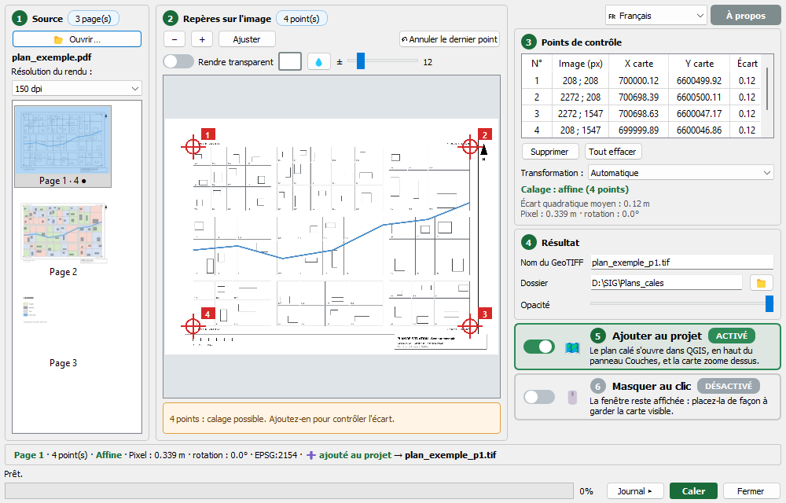
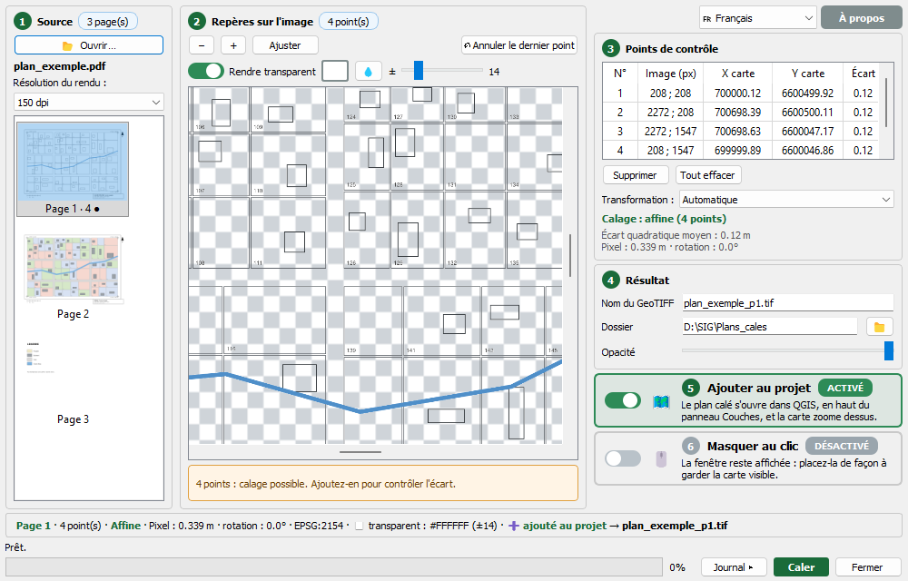
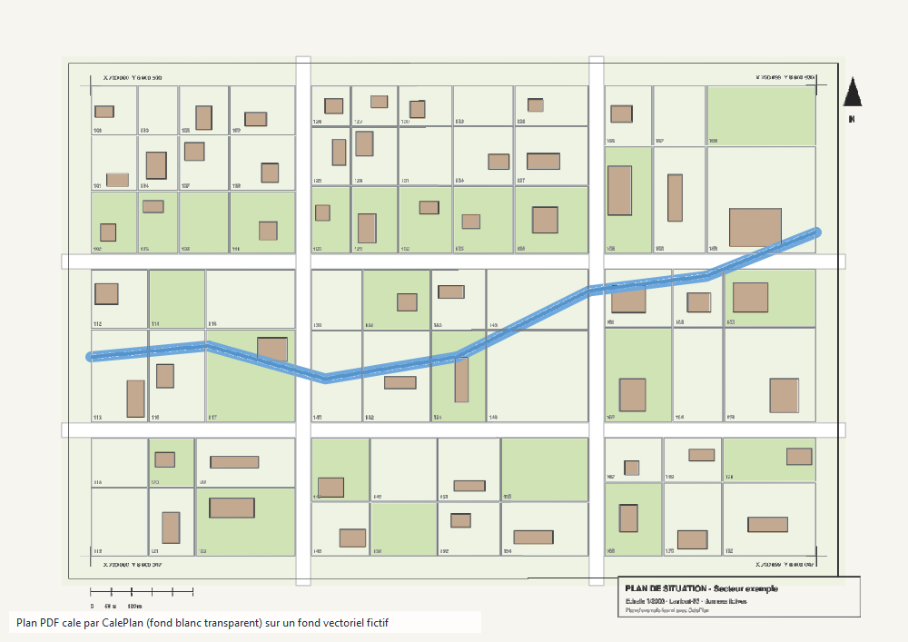
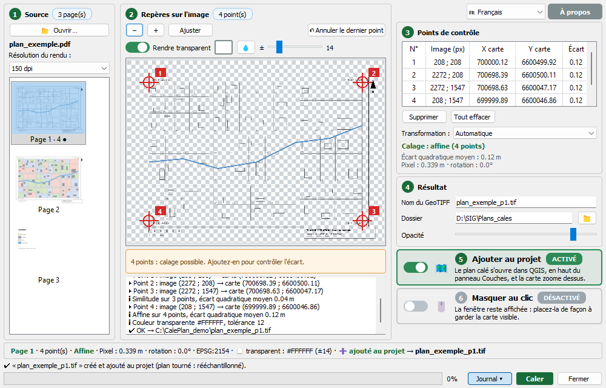
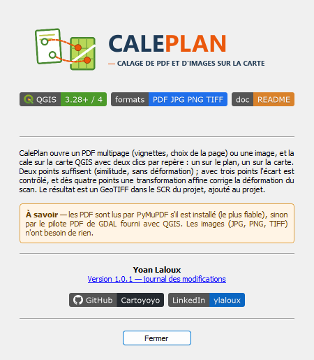

<div align="center">

# 

**Cale un PDF (la page de votre choix) ou une image sur la carte QGIS : un clic sur le plan, un clic sur la carte, et le GeoTIFF calé s'ajoute au projet.**

[](https://qgis.org)
[](metadata.txt)
[](LICENSE)
[](#français)

</div>

---

<div align="center">

## Aperçu rapide · Quick Overview

| Étape 1 — Placer les repères | Étape 2 — Rendre le fond transparent | Étape 3 — Résultat sur la carte |
|:---:|:---:|:---:|
|  |  |  |
| Pages du PDF à gauche,<br>repères sur l'image,<br>écart par point | Pipette + tolérance,<br>aperçu sur damier<br>avant d'écrire | Plan calé, fond blanc<br>transparent, sur un<br>fond vectoriel fictif |

| Journal · Log | À propos · About |
|:---:|:---:|
|  |  |
| Chaque repère, la transformation<br>et le fichier écrit | Même charte que mes autres<br>plugins QGIS |

</div>

---

## Français

### Description

CalePlan ouvre un PDF multipage ou une image (JPG, PNG, TIFF, BMP, GIF) et la cale sur la carte QGIS à partir de repères que vous pointez deux fois : une fois sur le plan, une fois sur la carte. Il calcule la transformation, écrit un GeoTIFF dans le SCR du projet et l'ajoute aux couches.

Fini l'aller-retour entre le géoréférenceur, le choix de la page d'un PDF et la couche à rajouter à la main : vous voyez les pages en vignettes, vous cliquez la page à caler, vous placez vos repères et l'écart par point s'affiche tout de suite. Si un 4e repère améliore le calage, vous recalez et l'image du projet est **remplacée** (même place, même nom, même opacité), sans doublon.

### Fonctionnalités

- **PDF multipage** : vignettes de toutes les pages, infobulle avec le format papier (A0 à A5 ou dimensions en mm), rendu en 100, 150, 200 ou 300 dpi (150 par défaut).
- **Images** : JPG, PNG, TIFF, BMP, GIF, ou glisser-déposer d'un fichier dans la fenêtre.
- **Deux clics par repère** : un sur l'image, puis le même point sur la carte QGIS. La fenêtre se masque le temps du clic (option) et Échap annule. Les coordonnées X/Y se corrigent aussi à la main dans le tableau.
- **Transformation adaptée au nombre de points** : similitude exacte à 2 points, similitude aux moindres carrés à 3 points (avec écart par point), affine à partir de 4 points. Choix « Automatique » ou forcé.
- **Contrôle du calage** : écart par point, écart quadratique moyen, taille du pixel, rotation. Alertes pour des points alignés, identiques, trop rapprochés, un effet miroir ou un SCR de projet géographique.
- **Couleur transparente** : pipette sur l'image, tolérance réglable, aperçu en direct sur damier. Le GeoTIFF reçoit une bande alpha (idéal pour le fond blanc d'un scan).
- **GeoTIFF propre** : compression DEFLATE, tuiles, pyramides ; un plan strictement sans rotation ni déformation est écrit sans rééchantillonnage ; dès qu'il y a la moindre rotation ou déformation, il est rééchantillonné (bilinéaire) avec des coins transparents.
- **Recalage sans doublon** : la couche existante est remplacée à la même place, avec le même nom, la même opacité et la même visibilité. Le fichier est d'abord écrit dans un fichier temporaire : si l'écriture échoue, l'ancien calage reste intact.
- **Visionneuse confortable** : zoom à la molette centré sur le curseur (jusqu'à 40 pixels d'écran par pixel d'image), déplacement au bouton du milieu ou en glissant, repères numérotés.
- **Journal** repliable et mémorisation de la langue, de la résolution et du dossier de sortie.
- **Interface en 5 langues** : FR, EN, ES, PT, DE.

### Prérequis

> **Recommandé** : [PyMuPDF](https://pymupdf.readthedocs.io/) (`pip install pymupdf` dans le Python de QGIS) pour lire les PDF : rapide et fiable. Licence AGPL, donc non embarqué dans le plugin.
> **Sinon** : le pilote PDF de GDAL fourni avec QGIS est utilisé. Les images (JPG, PNG, TIFF…) n'ont besoin de rien.

- QGIS 3.28 ou plus. Le code est écrit pour Qt 5 et Qt 6 (`supportsQt6`), mais **QGIS 4 n'a pas encore été testé**.
- Un SCR de projet **projeté** (par exemple EPSG:2154) : en degrés, le calage est refusé.

### Installation

1. Cloner le dépôt ou télécharger le ZIP :
   ```bash
   git clone https://github.com/Cartoyoyo/CalePlan.git
   ```
2. Placer le dossier `CalePlan` dans le dossier des extensions de QGIS :

   | Système | Chemin |
   |---------|--------|
   | Windows | `C:\Users\<utilisateur>\AppData\Roaming\QGIS\QGIS3\profiles\default\python\plugins\` |
   | macOS   | `~/Library/Application Support/QGIS/QGIS3/profiles/default/python/plugins/` |
   | Linux   | `~/.local/share/QGIS/QGIS3/profiles/default/python/plugins/` |

3. Dans QGIS : *Extensions → Installer/Gérer les extensions → Installées*, cocher **CalePlan**.
4. Une icône apparaît dans la barre des extensions et une entrée dans le menu *Extensions → CalePlan*.

### Utilisation

Un plan d'exemple fictif est fourni : [`docs/exemple/plan_exemple.pdf`](docs/exemple/plan_exemple.pdf) (3 pages A3, échelle 1/2000). La page 1 porte quatre croix de coordonnées avec leurs valeurs Lambert-93 :

| Croix | X | Y |
|-------|---|---|
| Haut gauche | 700 000 | 6 600 500 |
| Haut droite | 700 699 | 6 600 500 |
| Bas droite | 700 699 | 6 600 047 |
| Bas gauche | 700 000 | 6 600 047 |

1. **Ouvrir** un PDF ou une image (bouton *Ouvrir…* ou glisser-déposer), puis cliquer la **page** à caler dans la colonne ①.
2. **Placer les repères** dans la zone ② : cliquer un point net du plan (croisement, angle de parcelle…), puis cliquer **le même point sur la carte QGIS**. Choisir des points éloignés les uns des autres.
3. **Contrôler** dans ③ : l'écart de chaque point et l'écart quadratique moyen. Ajouter un point pour vérifier, en supprimer un mauvais.

   | Points | Transformation | Contrôle |
   |:---:|---|---|
   | 2 | Similitude (translation, rotation, échelle uniforme) | solution exacte, pas d'écart mesurable |
   | 3 | Similitude aux moindres carrés | écart par point |
   | 4 et plus | Affine aux moindres carrés (corrige la déformation du scan) | écart par point et écart quadratique moyen |

   Une affine sur 3 points est exacte, donc sans contrôle : le mode automatique ne la choisit qu'à partir de 4 points.
4. **Rendre une couleur transparente** (facultatif) : activer *Rendre transparent*, cliquer la pipette 💧 puis la couleur sur l'image (le fond blanc d'un scan, par exemple), régler la tolérance en regardant le damier.
5. **Caler** : donner le nom du GeoTIFF et le dossier (④), régler l'opacité, laisser *Ajouter au projet* activé (⑤), puis cliquer **Caler**. Pour recaler, ajouter ou déplacer un repère et cliquer de nouveau : l'image du projet est remplacée.

Si la fenêtre cache la carte, laisser *Masquer au clic* activé (⑥) : elle disparaît le temps du clic sur la carte puis revient.

### Limites connues

- Un PDF protégé par mot de passe n'est pas lu.
- Un PDF est transformé en image : le vectoriel n'est pas conservé. Au-delà de 12 000 pixels de côté, la résolution du rendu est réduite automatiquement (pour un PDF, la ligne d'état indique la résolution réellement utilisée).
- Une seule couleur transparente à la fois, avec un seul critère d'écart (le plus grand écart sur les canaux rouge, vert et bleu).
- Pas de transformation polynomiale, projective ou par « thin plate spline » : similitude et affine uniquement.

---

## English

### Description

CalePlan opens a multi-page PDF or an image (JPG, PNG, TIFF, BMP, GIF) and georeferences it on the QGIS map from landmarks you click twice: once on the plan, once on the map. It computes the transformation, writes a GeoTIFF in the project CRS and adds it to the layers.

No more juggling between the georeferencer, picking a PDF page and adding the layer by hand: you see the pages as thumbnails, click the page to georeference, place your landmarks and get the error per point right away. If a 4th landmark improves the fit, georeference again and the project layer is **replaced** (same position, same name, same opacity) with no duplicate.

### Features

- **Multi-page PDF**: thumbnails of every page, tooltip with the paper size (A0 to A5 or dimensions in mm), rendered at 100, 150, 200 or 300 dpi (150 by default).
- **Images**: JPG, PNG, TIFF, BMP, GIF, or drag and drop a file into the window.
- **Two clicks per landmark**: one on the image, then the same point on the QGIS map. The window hides during the click (option) and Esc cancels. X/Y can also be edited by hand in the table.
- **Transformation matched to the number of points**: exact similarity with 2 points, least-squares similarity with 3 points (with error per point), affine from 4 points. "Automatic" or forced.
- **Fit check**: error per point, root mean square error, pixel size, rotation. Warnings for collinear, identical or very close points, a mirrored result or a geographic project CRS.
- **Transparent colour**: eyedropper on the image, adjustable tolerance, live preview on a checkerboard. The GeoTIFF gets an alpha band (handy for the white background of a scan).
- **Clean GeoTIFF**: DEFLATE compression, tiles, overviews; a plan with strictly no rotation or distortion is written without resampling; as soon as there is any rotation or distortion it is resampled (bilinear) with transparent corners.
- **Re-georeferencing without duplicates**: the existing layer is replaced at the same position, with the same name, opacity and visibility. The file is first written to a temporary file: if writing fails, the previous fit stays intact.
- **Comfortable viewer**: mouse-wheel zoom centred on the cursor (up to 40 screen pixels per image pixel), pan with the middle button or by dragging, numbered landmarks.
- Collapsible **log**; language, resolution and output folder are remembered.
- **Interface in 5 languages**: FR, EN, ES, PT, DE.

### Requirements

> **Recommended**: [PyMuPDF](https://pymupdf.readthedocs.io/) (`pip install pymupdf` in QGIS's Python) to read PDFs: fast and reliable. AGPL licence, so it is not bundled with the plugin.
> **Otherwise**: the GDAL PDF driver shipped with QGIS is used. Images (JPG, PNG, TIFF…) need nothing extra.

- QGIS 3.28 or later. The code targets Qt 5 and Qt 6 (`supportsQt6`), but **QGIS 4 has not been tested yet**.
- A **projected** project CRS (e.g. EPSG:2154): in degrees the fit is refused.

### Installation

1. Clone the repository or download the ZIP:
   ```bash
   git clone https://github.com/Cartoyoyo/CalePlan.git
   ```
2. Put the `CalePlan` folder in the QGIS plugins folder (paths in the table above).
3. In QGIS: *Plugins → Manage and Install Plugins → Installed*, tick **CalePlan**.
4. An icon appears in the plugins toolbar and an entry in the *Plugins → CalePlan* menu.

### Usage

A fictitious sample plan is provided: [`docs/exemple/plan_exemple.pdf`](docs/exemple/plan_exemple.pdf) (3 A3 pages, scale 1/2000). Page 1 has four coordinate crosses labelled with their Lambert-93 values (see the table above).

1. **Open** a PDF or an image (*Open…* button or drag and drop), then click the **page** to georeference in column ①.
2. **Place landmarks** in area ②: click a sharp point of the plan (crossing, parcel corner…), then click **the same point on the QGIS map**. Choose points far from each other.
3. **Check** in ③: the error of each point and the root mean square error. Add a point to verify, delete a bad one.

   | Points | Transformation | Check |
   |:---:|---|---|
   | 2 | Similarity (translation, rotation, uniform scale) | exact solution, no measurable error |
   | 3 | Least-squares similarity | error per point |
   | 4 or more | Least-squares affine (corrects scan distortion) | error per point and RMS error |

   An affine on 3 points is exact, hence unchecked: Automatic mode only picks it from 4 points.
4. **Make a colour transparent** (optional): switch on *Make transparent*, click the eyedropper 💧 then the colour on the image (a scan's white background, for instance), and tune the tolerance while watching the checkerboard.
5. **Georeference**: set the GeoTIFF name and folder (④), adjust the opacity, keep *Add to the project* on (⑤), then click **Georeference**. To redo it, add or move a landmark and click again: the project layer is replaced.

If the window covers the map, keep *Hide on click* on (⑥): it disappears for the click on the map, then comes back.

### Known limits

- A password-protected PDF is not read.
- A PDF is turned into an image: vector data is not kept. Beyond 12,000 pixels on a side the render resolution is lowered automatically (for a PDF, the status line shows the resolution actually used).
- One transparent colour at a time, with a single distance criterion (the largest difference over the red, green and blue channels).
- No polynomial, projective or thin-plate-spline transformation: similarity and affine only.

---

## Español

> Las capturas de pantalla del flujo de trabajo se encuentran en la sección [Aperçu rapide](#aperçu-rapide--quick-overview) al inicio de este documento.

### Descripción

CalePlan abre un PDF de varias páginas (miniaturas, elección de la página) o una imagen y la georreferencia en el mapa de QGIS con dos clics por punto: uno en el plano y otro en el mapa. Dos puntos bastan (semejanza, sin deformación); con tres puntos se controla el error y desde cuatro una transformación afín corrige la deformación del escaneado. El resultado es un GeoTIFF en el SRC del proyecto, añadido al proyecto. Al volver a georreferenciar, la capa se **sustituye** sin duplicados.

### Funcionalidades

- PDF de varias páginas con miniaturas y renderizado a 100, 150, 200 o 300 dpi; imágenes JPG, PNG, TIFF, BMP, GIF.
- Error por punto y error cuadrático medio; avisos para puntos alineados, idénticos o muy cercanos, efecto espejo y SRC geográfico.
- Color transparente con cuentagotas, tolerancia y vista previa sobre damero (banda alfa en el GeoTIFF).
- GeoTIFF DEFLATE con pirámides; zoom con la rueda centrado en el cursor; interfaz en 5 idiomas.
- Requisitos: QGIS 3.28 o superior; PyMuPDF recomendado para los PDF (si no, se usa el controlador PDF de GDAL). QGIS 4 aún no se ha probado.

### Instalación

1. Clonar el repositorio: `git clone https://github.com/Cartoyoyo/CalePlan.git`
2. Copiar la carpeta `CalePlan` en la carpeta de complementos de QGIS (rutas en la tabla de la sección Français).
3. *Complementos → Administrar e instalar complementos → Instalados*: marcar **CalePlan**.

---

## Português

> As capturas de ecrã do fluxo de trabalho encontram-se na secção [Aperçu rapide](#aperçu-rapide--quick-overview) no início deste documento.

### Descrição

O CalePlan abre um PDF com várias páginas (miniaturas, escolha da página) ou uma imagem e georreferencia-a no mapa do QGIS com dois cliques por ponto: um na planta e outro no mapa. Dois pontos bastam (semelhança, sem deformação); com três pontos o erro é controlado e a partir de quatro uma transformação afim corrige a deformação da digitalização. O resultado é um GeoTIFF no SRC do projeto, adicionado ao projeto. Ao georreferenciar de novo, a camada é **substituída** sem duplicados.

### Funcionalidades

- PDF com várias páginas, miniaturas e renderização a 100, 150, 200 ou 300 dpi; imagens JPG, PNG, TIFF, BMP, GIF.
- Erro por ponto e erro quadrático médio; avisos para pontos alinhados, idênticos ou muito próximos, efeito espelho e SRC geográfico.
- Cor transparente com conta-gotas, tolerância e pré-visualização em tabuleiro (banda alfa no GeoTIFF).
- GeoTIFF DEFLATE com pirâmides; zoom com a roda centrado no cursor; interface em 5 idiomas.
- Requisitos: QGIS 3.28 ou superior; PyMuPDF recomendado para os PDF (caso contrário usa-se o controlador PDF do GDAL). O QGIS 4 ainda não foi testado.

### Instalação

1. Clonar o repositório: `git clone https://github.com/Cartoyoyo/CalePlan.git`
2. Copiar a pasta `CalePlan` para a pasta de módulos do QGIS (caminhos na tabela da secção Français).
3. *Módulos → Gerir e instalar módulos → Instalados*: assinalar **CalePlan**.

---

## Deutsch

> Die Screenshots des Arbeitsablaufs finden Sie im Abschnitt [Aperçu rapide](#aperçu-rapide--quick-overview) am Anfang dieses Dokuments.

### Beschreibung

CalePlan öffnet ein mehrseitiges PDF (Vorschaubilder, Seitenwahl) oder ein Bild und georeferenziert es in der QGIS-Karte mit zwei Klicks pro Punkt: einer im Plan, einer in der Karte. Zwei Punkte genügen (Ähnlichkeit, ohne Verzerrung); mit drei Punkten wird der Fehler kontrolliert, ab vier Punkten korrigiert eine affine Transformation die Verzerrung des Scans. Ergebnis ist ein GeoTIFF im Projekt-KBS, das dem Projekt hinzugefügt wird. Bei erneuter Georeferenzierung wird die Ebene **ersetzt**, ohne Duplikat.

### Funktionen

- Mehrseitiges PDF mit Vorschaubildern und Rendering mit 100, 150, 200 oder 300 dpi; Bilder JPG, PNG, TIFF, BMP, GIF.
- Fehler pro Punkt und mittlerer quadratischer Fehler; Warnungen bei kollinearen, identischen oder sehr nahen Punkten, Spiegelung und geographischem KBS.
- Transparente Farbe mit Pipette, Toleranz und Vorschau auf Schachbrett (Alphakanal im GeoTIFF).
- GeoTIFF mit DEFLATE und Übersichten; Mausrad-Zoom auf den Cursor; Oberfläche in 5 Sprachen.
- Voraussetzungen: QGIS 3.28 oder neuer; PyMuPDF für PDFs empfohlen (sonst der GDAL-PDF-Treiber). QGIS 4 wurde noch nicht getestet.

### Installation

1. Repository klonen: `git clone https://github.com/Cartoyoyo/CalePlan.git`
2. Den Ordner `CalePlan` in den QGIS-Plugin-Ordner kopieren (Pfade in der Tabelle im Abschnitt Français).
3. *Erweiterungen → Erweiterungen verwalten und installieren → Installiert*: **CalePlan** aktivieren.

---

## Architecture

Le plugin est découpé en trois couches :

- `core/` : fonctions pures sans interface (lecture PDF et images, calcul du calage, écriture du GeoTIFF, couleur transparente). Elles se testent sans ouvrir de fenêtre.
- `ui/` : fenêtre principale, visionneuse, outil de clic sur la carte, composants graphiques communs et fenêtre « À propos ».
- `plugin.py`, `i18n.py` : branchement dans QGIS (barre d'outils, menu) et textes en 5 langues.

L'écriture du GeoTIFF se fait dans un fil séparé : l'interface reste libre pendant l'écriture. Il n'y a pas encore de diagramme `architecture.d2`.

## Changelog

| Version | Notes |
|---------|-------|
| **1.0.1** | Publication automatique par tag (workflow GitHub) — logo en tête du README — aucun changement de fonctionnement |
| **1.0.0** | Première version — PDF (choix de la page, vignettes) ou image — clic sur le plan puis sur la carte — similitude dès 2 points, affine dès 4 points — GeoTIFF dans le SCR du projet — couleur transparente (pipette, tolérance, aperçu) — recalage qui remplace la couche — interface en 5 langues |

Détail dans [`CHANGELOG.md`](CHANGELOG.md).

---

## Auteur · Author

<div align="center">

Développé par / Developed by **Yoan Laloux**

[](https://www.linkedin.com/in/ylaloux/)
[](https://github.com/Cartoyoyo)

*Concept et idée originale par Yoan Laloux — développé avec l'assistance d'outils d'IA générative.*
*Concept and original idea by Yoan Laloux — developed with the assistance of generative AI tools.*

</div>

## Licence · License

Ce plugin est distribué sous licence **GNU GPL v3** — voir [`LICENSE`](LICENSE).
This plugin is released under the **GNU GPL v3** licence — see [`LICENSE`](LICENSE).

Signaler un problème ou proposer une amélioration : [issues](https://github.com/Cartoyoyo/CalePlan/issues).
